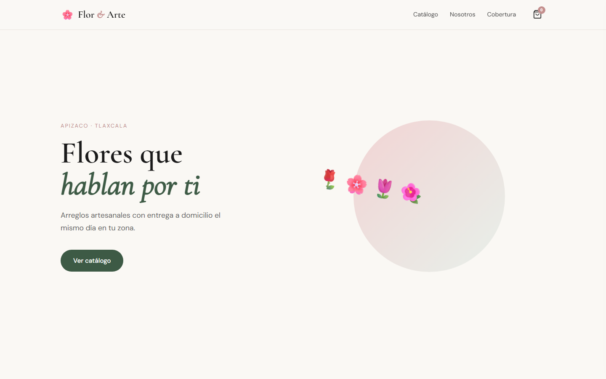
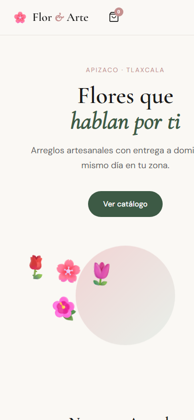

# Flor & Arte — Online Flower Shop (Frontend)


Storefront for a local flower shop in Apizaco, Tlaxcala, built without frameworks. It works together with the REST API in [floreria-backend](https://github.com/cantedavid00-afk/floreria-backend).

**Static site:** https://floreria-frontend-seven.vercel.app · The backend API is no longer deployed, so the live catalog and checkout are not functional.



## Features

- **Catalog** loaded from the API (`GET /api/productos`).
- **Shopping cart** persisted in `localStorage`, with defensive loading and saving.
- **Checkout** with customer details, delivery address, postal-code validation for the delivery area, and delivery date and time; it creates an order through `POST /api/pedidos`.
- **Admin dashboard** (`admin-dashboard.html`): login against the API, order list with status filter and payment-status badges.
- Responsive layout (desktop and mobile).

## Backend (separate repository)

[floreria-backend](https://github.com/cantedavid00-afk/floreria-backend) is built with Node.js and Express, MongoDB (Mongoose), JWT authentication with bcrypt-hashed passwords, `helmet`, rate limiting, `express-mongo-sanitize`, and a WhatsApp notification service.

## Project Structure

```text
index.html             catalog and landing page
checkout.html          order form
admin-dashboard.html   order management
css/styles.css
js/config.js           API base URL
js/catalogo.js         catalog rendering
js/carrito.js          cart state (localStorage)
```

## Running Locally

Serve the folder with any static server and point `js/config.js` to a running instance of the backend:

```bash
npx serve .
```

## Screenshots

| Desktop | Mobile |
|---|---|
|  |  |
